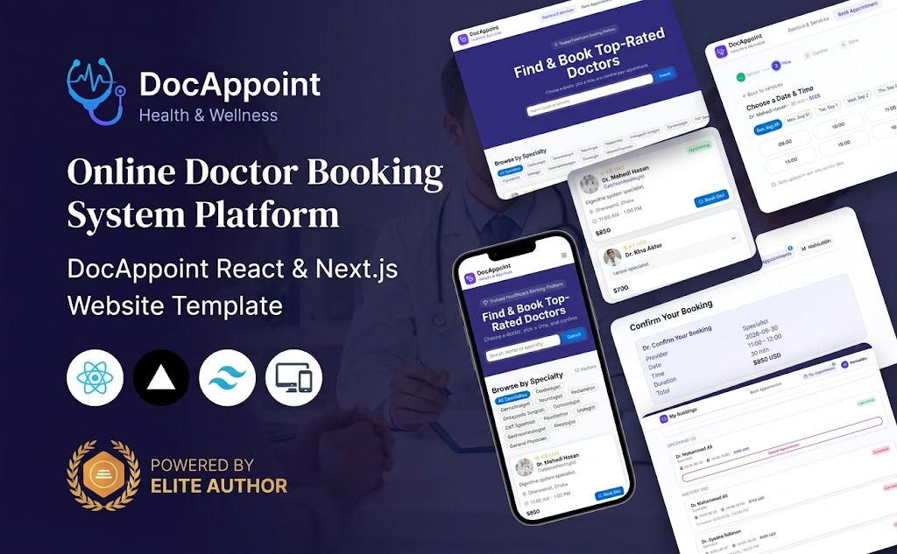

# 🩺 DocAppoint — Modern Doctor Appointment & Healthcare Booking System

<div align="center">

[](https://nextjs.org/)
[](https://react.dev/)
[](https://www.typescriptlang.org/)
[](https://tailwindcss.com/)
[](https://www.better-auth.com/)
[](https://www.mongodb.com/)
[](https://doc-appoint-omega.vercel.app/)

<p align="center">
  A full-featured, modern, and high-performance doctor appointment booking web application built with <strong>Next.js 16 App Router</strong>, <strong>React 19</strong>, <strong>TypeScript</strong>, and <strong>Tailwind CSS</strong>.
</p>

[**🌐 Live Demo**](https://doc-appoint-omega.vercel.app/) • [**✨ Features**](#-key-features) • [**🚀 Getting Started**](#-getting-started) • [**📂 Project Structure**](#-project-structure)

<br />



</div>

---

## 🌟 Overview

**DocAppoint** is designed to streamline the healthcare booking experience for both patients and healthcare providers. It provides an intuitive interface for exploring medical specialties, searching specialist doctors, choosing dates and real-time time slots, managing bookings, and tracking appointment history in a single, unified platform.

---

## ✨ Key Features

- **🔍 Smart Doctor & Specialty Search**
  - Explore top medical specialists categorized by department (Cardiology, Neurology, Dermatology, Orthopedics, and more).
  - Instant client-side search by doctor name, specialty, and location.

- **📅 Guided 3-Step Booking Flow**
  - **Step 1 — Service & Doctor Selection**: Select your doctor and preferred medical consultation service.
  - **Step 2 — Date & Time Slot Picker**: Dynamic 7-day calendar selector with real-time morning/evening slot availability.
  - **Step 3 — Patient Details & Confirmation**: Form validation for patient name, email, phone number, and reason for visit with an instant summary review.

- **⚡ Real-Time Slot Collision Prevention**
  - Slots are instantly marked as unavailable upon successful booking to prevent double-booking.
  - Cancelling an appointment automatically frees up the slot for other patients.

- **📋 Appointment Management ("My Appointments")**
  - Dedicated dashboard to review upcoming, completed, and cancelled appointments.
  - One-click appointment cancellation with real-time status updates and toast feedback.

- **🔐 Robust Authentication & Security**
  - Powered by **Better Auth** with MongoDB adapter.
  - Email/password authentication, persistent session management, and responsive login/register modals.

- **📱 100% Mobile Responsive & Modern UI**
  - Clean pill-style aesthetics, glassmorphic cards, smooth micro-interactions, and custom dark accent elements.
  - Optimized for all screen sizes — from ultra-compact smartphones to large desktop monitors.

- **🔔 Instant Feedback & Validation**
  - Interactive toast notifications via `react-hot-toast` for user actions and error handling.

---

## 🛠️ Tech Stack

| Technology | Category | Purpose |
| :--- | :--- | :--- |
| **[Next.js 16](https://nextjs.org/)** | Framework | React framework with Turbopack, App Router, and Server Actions |
| **[React 19](https://react.dev/)** | Library | Core component-based UI rendering |
| **[TypeScript](https://www.typescriptlang.org/)** | Language | Type safety, maintainability, and clean code contracts |
| **[Tailwind CSS](https://tailwindcss.com/)** | Styling | Utility-first responsive CSS styling with custom modern design system |
| **[HeroUI](https://www.heroui.com/)** | UI Components | Accessible, polished UI primitives |
| **[Zustand](https://zustand.docs.pmnd.rs/)** | State Management | Lightweight reactive state stores for services and bookings |
| **[Better Auth](https://www.better-auth.com/)** | Authentication | Modern authentication layer with MongoDB adapter |
| **[MongoDB](https://www.mongodb.com/)** | Database | Database for user sessions, profiles, and appointment records |
| **[React Icons](https://react-icons.github.io/react-icons/)** | Icons | Rich icon set across all pages and buttons |

---

## 📑 Application Routes

| Route | Page | Purpose |
| :--- | :--- | :--- |
| `/` | **Home Page** | Hero section, specialties catalogue, featured doctors grid, statistics band, testimonials, and FAQs. |
| `/services` | **Services & Doctors** | Comprehensive doctor catalogue with filtering, real-time search, and direct booking triggers. |
| `/booking` | **Interactive Booking** | Step-by-step guided booking wizard (Doctor -> Date/Slot -> Patient Info -> Confirmation). |
| `/appointments` | **My Appointments** | Patient dashboard to track upcoming bookings, view appointment details, and cancel visits. |
| `/api/auth/[...all]` | **Auth Endpoint** | Better Auth API handler for session management and authentication requests. |

---

## 🚀 Getting Started

Follow these steps to run the project locally on your machine:

### 1. Prerequisites
- **Node.js** v18.18+ or v20+ installed
- **npm** or **pnpm** / **yarn**
- A **MongoDB** database instance (local or MongoDB Atlas connection string)

### 2. Clone the Repository

```bash
git clone https://github.com/mohiuddinshanto/doc_appoint.git
cd doc_appoint
```

### 3. Install Dependencies

```bash
npm install
```

### 4. Configure Environment Variables

Create a `.env.local` file in the root directory:

```env
# Backend API URL (optional if using internal API routes)
NEXT_PUBLIC_BACKEND_URL=https://your-backend-api.vercel.app

# Better Auth Configuration
BETTER_AUTH_URL=http://localhost:3000
BETTER_AUTH_SECRET=your_super_secret_key_here

# MongoDB Connection
MONGODB_URI=mongodb+srv://<username>:<password>@<cluster-url>/
MONGODB_DB_NAME=docappoint_db
```

> **Note:** Generate a secure random string for `BETTER_AUTH_SECRET` (e.g., using `openssl rand -base64 32`).

### 5. Start the Development Server

```bash
npm run dev
```

Open [http://localhost:3000](http://localhost:3000) in your browser to view the application.

---

## 💻 Available Scripts

| Script | Description |
| :--- | :--- |
| `npm run dev` | Runs the development server with Next.js Turbopack |
| `npm run build` | Builds the optimized production build |
| `npm run start` | Starts the production server |
| `npm run lint` | Runs ESLint to check for code quality and syntax issues |

---

## 📂 Project Structure

```text
frontend/doc_appoint/
├── app/
│   ├── api/auth/[...all]/    # Better Auth route handlers
│   ├── appointments/         # My Appointments dashboard page
│   ├── booking/              # Multi-step booking page
│   ├── services/             # Doctors and services directory page
│   ├── globals.css           # Global Tailwind styles & custom utilities
│   ├── layout.tsx            # Root layout with responsive viewport & fonts
│   └── page.tsx              # Home landing page
├── components/
│   ├── appointments/         # Appointment cards & list components
│   ├── auth/                 # Login & Registration modals
│   ├── booking/              # ServiceStep, SlotStep, ConfirmStep components
│   ├── home/                 # Hero, DoctorCard, DoctorGrid, Band, CTA, FAQ, Footer
│   ├── navbar/               # Responsive header, navlinks & mobile menu
│   ├── services/             # Services page filtering & layout
│   └── ui/                   # Custom buttons, modals, badges, inputs
├── hooks/                    # Custom React hooks
├── lib/                      # Auth configuration, API clients & helpers
├── store/                    # Zustand stores (bookingStore, userStore, etc.)
├── types/                    # TypeScript type definitions and interfaces
├── public/                   # Static assets, logos & screenshots
├── tailwind.config.ts        # Tailwind CSS configuration
└── package.json              # Project dependencies and scripts
```

---

## 💡 Booking Architecture & Logic

```
   [ Patient Browsing ]
           │
           ▼
 [ Select Doctor & Service ]
           │
           ▼
[ Choose Date & Available Slot ]  ◄── (Dynamic 7-day rolling window)
           │
           ▼
  [ Enter Patient Details ]      ◄── (Validation: Name, Email, Phone)
           │
           ▼
  [ Confirm Appointment ]
           │
           ├─► Slot is locked immediately (Prevents duplicate booking)
           └─► Appointment saved in MongoDB / Zustand store
                   │
                   ▼
       [ "My Appointments" Dashboard ]
                   │
                   └─► Cancel Appointment ──► Slot automatically released
```

---

## 👨‍💻 Author

**Mohiuddin Shanto**
- **Role:** Frontend Developer / Full Stack Intern Candidate
- **GitHub:** [@mohiuddinshanto](https://github.com/mohiuddinshanto)
- **Live Demo:** [DocAppoint on Vercel](https://doc-appoint-omega.vercel.app/)

---

## 📄 License

This project is open-source and available under the [MIT License](LICENSE).
